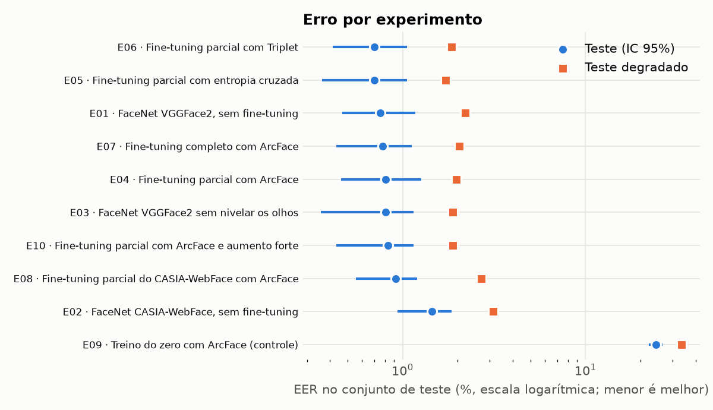
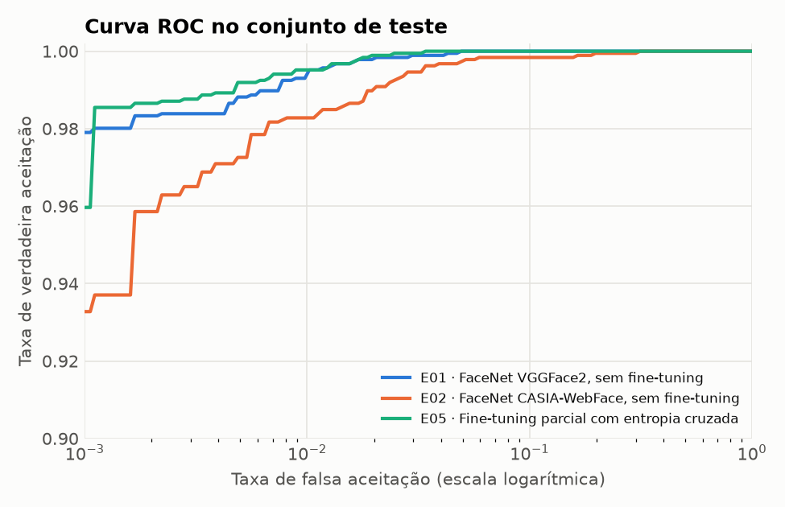

# Sistema de Reconhecimento Facial

Trabalho da disciplina de Inteligência Artificial (UFMS). Investiga experimentalmente
a melhor configuração de reconhecimento facial e a usa em uma aplicação web local com
câmera, cadastro, reconhecimento e exclusão de pessoas.

> **Uso restrito.** Apenas para fins acadêmicos e com pessoas que consentiram. Vigilância
> ou identificação não consentida não são autorizadas. Ver [LGPD](docs/privacy/LGPD.md).

Ao clonar, a aplicação começa com **"Nenhuma pessoa cadastrada"**. Fotos, embeddings e
bancos nunca fazem parte do repositório.

## Instalação

Requer Python 3.11 ou superior. O ambiente fica **fora** de pastas sincronizadas (no
Windows, `%LOCALAPPDATA%\facerec-ufms`).

```bash
python -m venv "$LOCALAPPDATA/facerec-ufms/venv"
source "$LOCALAPPDATA/facerec-ufms/venv/Scripts/activate"
pip install torch==2.11.0 torchvision==0.26.0 --index-url https://download.pytorch.org/whl/cu128
pip install -r requirements.txt
pip install facenet-pytorch==2.6.0 --no-deps
pip install -e . --no-deps
```

## Execução

O checkpoint da configuração escolhida é gerado localmente, em poucos minutos com GPU:

```bash
python scripts/prepare_lfw.py
python experiments/run_experiments.py --only E05
python -m facerec.app
```

Abra <http://127.0.0.1:8000>. Para reproduzir todos os experimentos:

```bash
python experiments/run_experiments.py
python experiments/summarize.py
```

Testes: `pytest` (dados sintéticos) e `pytest -m slow` (pesos reais e LFW local).

## Arquitetura

```
Imagem → MTCNN (detecção + landmarks) → alinhamento → FaceNet (embedding 512-d)
       → protótipo por pessoa (cosseno) → threshold → reconhecido ou desconhecido
```

| Módulo | Responsabilidade |
|---|---|
| `facerec/app` | HTTP local e interface |
| `facerec/service.py` | Casos de uso: cadastrar, reconhecer, excluir |
| `facerec/vision.py`, `imaging.py`, `quality.py` | Detecção, embedding, alinhamento e qualidade |
| `facerec/matching.py` | Comparação e regra de decisão |
| `facerec/storage.py` | Galeria SQLite e exclusão completa |
| `facerec/config.py` | Configuração externa (`configs/app.yaml`) e guarda de privacidade |
| `facerec/training` | Divisão, perdas, treino e métricas da Parte 1 |

O desenvolvimento seguiu Spec-Driven Development: requisitos e critérios em
[`docs/specs`](docs/specs), decisões em [`docs/decisions`](docs/decisions), e os testes
citam o critério que verificam (`test_ca_002_3_...`).

## Datasets

**LFW (Labeled Faces in the Wild)**

- Fonte oficial: <https://vis-www.cs.umass.edu/lfw/> (University of Massachusetts Amherst).
- Finalidade: benchmark acadêmico de reconhecimento facial.
- Termos: **a confirmar pelo grupo na página oficial antes da entrega** (Anexo B). O site estava inacessível quando o projeto foi preparado.
- Uso: 13.233 imagens de 5.749 pessoas, para fine-tuning, validação e teste. O arquivo veio do espelho no Figshare também usado pelo scikit-learn, com SHA-256 conferido. **Não é redistribuído aqui.**

**Pesos pré-treinados**: `facenet-pytorch` (<https://github.com/timesler/facenet-pytorch>), baixados por referência, treinados em VGGFace2 e CASIA-WebFace.

**Dataset privado**: fotos dos integrantes, com consentimento, somente locais. Ver [data/README.md](data/README.md).

## Protocolo experimental

- Divisão **por identidade** (60/20/20, semente 42): nenhuma pessoa está em dois conjuntos.
- Hash perceptual removeu 18 imagens do treino e 5 da validação, quase iguais às de outros conjuntos. O teste não foi alterado.
- Treino com 5.737 imagens de 1.008 pessoas. Validação com 2.613 imagens de 1.148 pessoas e teste com 2.424 de 1.150.
- Parada antecipada, modelo, comparador e threshold usam **apenas a validação**.
- Lotes PK (32 pessoas × 4 imagens), AdamW, cosine annealing, até 20 épocas, paciência de 4. Hiperparâmetros em [`configs/experiments.yaml`](configs/experiments.yaml); versões e hardware em cada `experiments/results/E*.json`.
- Python 3.13.14, PyTorch 2.11.0, GeForce RTX 3060 12 GB.

## Resultados

Accuracy e F1 no teste, com o threshold de EER obtido na validação.

| Experimento | Modelo | Estratégia | Dataset | Accuracy | F1 | Observação |
|---|---|---|---|---|---|---|
| E01 | FaceNet VGGFace2 | baseline | público | 0,9919 | 0,9919 | Referência; EER val 0,0079 |
| E02 | FaceNet CASIA | baseline | público | 0,9863 | 0,9863 | Pior ponto de partida; EER val 0,0167 |
| E03 | FaceNet VGGFace2 | baseline sem nivelar olhos | público | 0,9925 | 0,9925 | Sem ganho do alinhamento |
| E04 | FaceNet VGGFace2 | fine-tuning parcial, ArcFace | público | 0,9914 | 0,9914 | EER val 0,0069 |
| **E05** | **FaceNet VGGFace2** | **fine-tuning parcial, softmax** | **público** | **0,9919** | **0,9920** | **Escolhido; EER val 0,0064** |
| E06 | FaceNet VGGFace2 | fine-tuning parcial, Triplet | público | 0,9930 | 0,9930 | EER val 0,0069 |
| E07 | FaceNet VGGFace2 | fine-tuning completo, ArcFace | público | 0,9925 | 0,9925 | 401 s, sem ganho |
| E08 | FaceNet CASIA | fine-tuning parcial, ArcFace | público | 0,9917 | 0,9917 | Maior ganho sobre seu baseline |
| E09 | Inception-ResNet | treino do zero, ArcFace | público | 0,7579 | 0,7572 | Controle; EER 24,3% |
| E10 | FaceNet VGGFace2 | fine-tuning parcial, ArcFace, aumento forte | público | 0,9914 | 0,9914 | EER val 0,0067 |
| P01 | Configuração E05 | avaliação | privado | *pendente* | *pendente* | Rodar `experiments/evaluate_private.py` |

Tabela completa (AUC, EER com IC 95%, FAR, FRR, teste degradado) e comparadores em
[`experiments/results/SUMMARY.md`](experiments/results/SUMMARY.md).





### Análise

**Qual foi melhor e por quê.** E05 teve o menor EER de validação e foi escolhido pela
regra definida previamente. Porém, as variantes VGGFace2 (E01, E03 a E07 e E10) têm
intervalos de confiança sobrepostos e são estatisticamente indistinguíveis. O fator
que realmente importou foi o **modelo de partida**: VGGFace2 supera CASIA, e ambos
superam em muito o treino do zero.

**Hipóteses.**

| Exp. | Hipótese | Resultado |
|---|---|---|
| E02 | VGGFace2 supera CASIA | Confirmada (EER val 0,0079 contra 0,0167) |
| E03 | Nivelar os olhos reduz o EER | **Não confirmada**: EER val idêntico (0,0079) e, no teste degradado, sem nivelar foi até melhor |
| E04 | ArcFace melhora o baseline | Inconclusiva: melhor na validação, pior no teste, dentro do ruído |
| E05 | Sem margem, ganho menor que E04 | **Refutada**: E05 foi igual ou melhor |
| E06 | Triplet próximo de ArcFace | Confirmada |
| E07 | Fine-tuning completo não supera o parcial | Confirmada, com custo 19 vezes maior (401 s contra 21 s) |
| E08 | Ganho maior no modelo mais fraco | Confirmada: EER de teste de 0,0145 para 0,0091 |
| E09 | LFW é pequeno demais para treinar do zero | Confirmada: EER de 24% |
| E10 | Aumento forte melhora o teste degradado | Inconclusiva: 0,0188 contra 0,0196 de E04, dentro do ruído |

**Impacto do fine-tuning.** Com VGGFace2, ganho pequeno e dentro da incerteza, pois o
pré-treinado já está perto do teto no LFW. No modelo mais fraco (CASIA), ganho claro. No
teste degradado, E05 ficou melhor que E01 (EER 0,0172 contra 0,0221), a diferença mais
sugestiva a favor do fine-tuning.

**Impacto do threshold.** Para o mesmo FAR, o threshold sobe com o tamanho da galeria. Reduzir o
FAR-alvo de 1% para 0,1% com 20 pessoas custa 6 pontos de identificação correta (97,0%
para 91,1%). Ver [ADR-003](docs/decisions/ADR-003-recognition-threshold.md).

**Custo e complexidade.** Baselines não exigem treino. O fine-tuning parcial leva cerca de 20 s
e o completo, 401 s, sem melhora. Com E05, a inferência levou 0,37 ms por recorte, em lote na GPU. O
ciclo completo na aplicação levou cerca de 110 ms em uma imagem de 250×250 (medição única).

**Erros e limitações.**

- O LFW satura as métricas: quase todos os modelos ficam acima de 99%, reduzindo o poder de comparação.
- Pessoas do LFW podem também estar no VGGFace2 ou no CASIA, o que pode inflar os baselines. Essa sobreposição não foi medida.
- O LFW tem erros de rótulo conhecidos e, no treino, poucas imagens por pessoa.
- Uma única semente foi usada; o intervalo por bootstrap não capta a variação entre treinos.
- A acurácia pode variar entre grupos demográficos, o que não foi avaliado aqui.
- Fotos ou vídeos da pessoa podem enganar o sistema, pois não há prova de vida.
- O banco não é cifrado: a proteção depende do controle de acesso da conta.

## Desenvolvimento assistido por IA

O projeto foi desenvolvido com Claude Code em processo orientado a especificações. O
agente recebeu apenas o enunciado, código e dados públicos ou sintéticos, nunca fotos de
participantes. A responsabilidade pelo código e pelas decisões é do(s) integrante(s).

## Privacidade

Ver [docs/privacy/LGPD.md](docs/privacy/LGPD.md), inclusive o checklist do Anexo B.
Antes de publicar, execute `python scripts/privacy_audit.py`.
