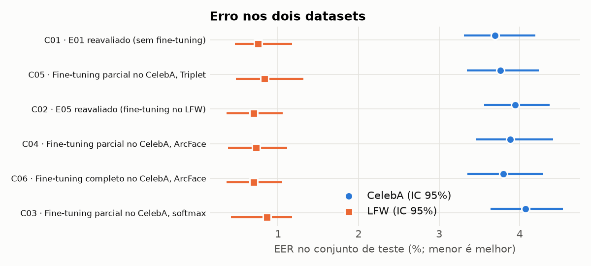
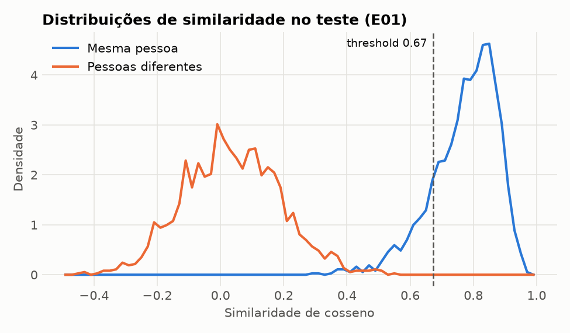

# Sistema de Reconhecimento Facial

Trabalho da disciplina de Inteligência Artificial (UFMS). Investiga experimentalmente
a melhor configuração de reconhecimento facial e a usa em uma aplicação web local com
câmera, cadastro, reconhecimento e exclusão de pessoas.

> **Uso restrito.** Apenas para fins acadêmicos e com pessoas que consentiram. Vigilância
> ou identificação não consentida não são autorizadas. Ver [LGPD](docs/privacy/LGPD.md).

Ao clonar, a aplicação começa com **"Nenhuma pessoa cadastrada"**. Fotos, embeddings e
bancos nunca fazem parte do repositório.

## Instalação

Requer Python 3.11 ou superior. O ambiente fica **fora** de pastas sincronizadas (no
Windows, `%LOCALAPPDATA%\facerec-ufms`).

```bash
python -m venv "$LOCALAPPDATA/facerec-ufms/venv"
source "$LOCALAPPDATA/facerec-ufms/venv/Scripts/activate"
pip install torch==2.11.0 torchvision==0.26.0 --index-url https://download.pytorch.org/whl/cu128
pip install -r requirements.txt
pip install facenet-pytorch==2.6.0 --no-deps
pip install -e . --no-deps
```

## Execução

A aplicação usa os pesos públicos, baixados automaticamente na primeira execução:

```bash
python -m facerec.app
```

Abra <http://127.0.0.1:8000>. Para reproduzir os experimentos:

```bash
python scripts/prepare_lfw.py
python experiments/run_experiments.py
python experiments/summarize.py
```

Os experimentos com CelebA estão descritos em [data/README.md](data/README.md).

Testes: `pytest` (dados sintéticos) e `pytest -m slow` (pesos reais e LFW local).

## Arquitetura

```
Imagem → MTCNN (detecção + landmarks) → alinhamento → FaceNet (embedding 512-d)
       → protótipo por pessoa (cosseno) → threshold → reconhecido ou desconhecido
```

| Módulo | Responsabilidade |
|---|---|
| `facerec/app` | HTTP local e interface |
| `facerec/service.py` | Casos de uso: cadastrar, reconhecer, excluir |
| `facerec/vision.py`, `imaging.py`, `quality.py` | Detecção, embedding, alinhamento e qualidade |
| `facerec/matching.py` | Comparação e regra de decisão |
| `facerec/storage.py` | Galeria SQLite e exclusão completa |
| `facerec/config.py` | Configuração externa (`configs/app.yaml`) e guarda de privacidade |
| `facerec/training` | Divisão, perdas, treino e métricas da Parte 1 |

O desenvolvimento seguiu Spec-Driven Development: requisitos e critérios em
[`docs/specs`](docs/specs), decisões em [`docs/decisions`](docs/decisions), e os testes
citam o critério que verificam (`test_ca_002_3_...`).

## Datasets

**LFW (Labeled Faces in the Wild)**

- Fonte oficial: <https://vis-www.cs.umass.edu/lfw/> (University of Massachusetts Amherst).
- Finalidade: benchmark acadêmico de reconhecimento facial.
- Termos: **não verificados.** Em novembro de 2026, o site oficial e a tentativa pelo Wayback Machine ficaram inacessíveis, então nenhuma licença é presumida aqui. O dataset é citado como exemplo no próprio enunciado da disciplina. Por precaução, foi usado só para fins acadêmicos e sem redistribuição.
- Uso: 13.233 imagens de 5.749 pessoas, para fine-tuning, validação e teste. O arquivo veio do espelho no Figshare também usado pelo scikit-learn, com SHA-256 conferido. **Não é redistribuído aqui.**

**CelebA (CelebFaces Attributes)**

- Fonte oficial: <https://mmlab.ie.cuhk.edu.hk/projects/CelebA.html> (MMLAB, CUHK).
- Finalidade: pesquisa acadêmica não comercial.
- Quem disponibilizou: MMLAB, The Chinese University of Hong Kong. As imagens vêm da Internet e não são propriedade do MMLAB.
- Termos (verificados no acordo da página oficial): somente pesquisa não comercial; proíbe copiar, publicar ou distribuir qualquer parte do dataset, salvo cópias para uso interno em um único local da mesma organização; proíbe exploração comercial das imagens e de dados derivados. O MMLAB pode encerrar o acesso a qualquer momento.
- Treinamento: o acordo não trata do tema de forma explícita. Foi entendido como parte da pesquisa não comercial.
- Identidades: segundo o acordo, são liberadas mediante solicitação, para pesquisa.
- **Procedência das imagens:** `img_align_celeba.zip` baixado da fonte oficial após o aceite do acordo, com MD5 `00d2c5bc6d35e252742224ab0c1e8fcb` conferido. Os experimentos haviam sido executados antes com uma cópia do Kaggle. O reprocessamento a partir do zip oficial gerou os mesmos 92.589 recortes, idênticos byte a byte, com os mesmos rótulos e partições, então os resultados valem para os dados oficiais. A cópia do Kaggle foi descartada.
- **Ressalva:** o arquivo de identidades veio do link no Google Drive oficial, com MD5 conferido, mas sem solicitação formal ao MMLAB.
- Uso: até 10 imagens por identidade (92.589 imagens de 10.177 pessoas), com a partição oficial. Imagens e identidades obtidas da fonte oficial, com MD5 conferido. **Nem as imagens nem checkpoints derivados são distribuídos aqui.**

**Pesos pré-treinados**: `facenet-pytorch` (<https://github.com/timesler/facenet-pytorch>), baixados por referência, treinados em VGGFace2 e CASIA-WebFace.

**Dataset privado**: fotos dos integrantes, com consentimento, somente locais. Ver [data/README.md](data/README.md).

## Protocolo experimental

- Divisão **por identidade** (60/20/20, semente 42): nenhuma pessoa está em dois conjuntos.
- Hash perceptual removeu 18 imagens do treino e 5 da validação, quase iguais às de outros conjuntos. O teste não foi alterado.
- Treino com 5.737 imagens de 1.008 pessoas. Validação com 2.613 imagens de 1.148 pessoas e teste com 2.424 de 1.150.
- Parada antecipada, modelo, comparador e threshold usam **apenas a validação**.
- Lotes PK (32 pessoas × 4 imagens), AdamW, cosine annealing, até 20 épocas, paciência de 4. Hiperparâmetros em [`configs/experiments.yaml`](configs/experiments.yaml); versões e hardware em cada `experiments/results/E*.json`.
- Python 3.13.14, PyTorch 2.11.0, GeForce RTX 3060 12 GB.

## Resultados

Accuracy e F1 no teste, com o threshold de EER obtido na validação.

| Experimento | Modelo | Estratégia | Dataset | Accuracy | F1 | Observação |
|---|---|---|---|---|---|---|
| E01 | FaceNet VGGFace2 | baseline | público | 0,9919 | 0,9919 | Referência; EER val 0,0079 |
| E02 | FaceNet CASIA | baseline | público | 0,9863 | 0,9863 | Pior ponto de partida; EER val 0,0167 |
| E03 | FaceNet VGGFace2 | baseline sem nivelar olhos | público | 0,9925 | 0,9925 | Sem ganho do alinhamento |
| E04 | FaceNet VGGFace2 | fine-tuning parcial, ArcFace | público | 0,9914 | 0,9914 | EER val 0,0069 |
| E05 | FaceNet VGGFace2 | fine-tuning parcial, softmax | público | 0,9919 | 0,9920 | Melhor só no LFW; EER val 0,0064 |
| E06 | FaceNet VGGFace2 | fine-tuning parcial, Triplet | público | 0,9930 | 0,9930 | EER val 0,0069 |
| E07 | FaceNet VGGFace2 | fine-tuning completo, ArcFace | público | 0,9925 | 0,9925 | 401 s, sem ganho |
| E08 | FaceNet CASIA | fine-tuning parcial, ArcFace | público | 0,9917 | 0,9917 | Maior ganho sobre seu baseline |
| E09 | Inception-ResNet | treino do zero, ArcFace | público | 0,7579 | 0,7572 | Controle; EER 24,3% |
| E10 | FaceNet VGGFace2 | fine-tuning parcial, ArcFace, aumento forte | público | 0,9914 | 0,9914 | EER val 0,0067 |
| P01 | FaceNet VGGFace2 (C01) | avaliação, sem treino | privado | 1,0000 | 1,0000 | 6 pessoas, 17 imagens, 32 pares; amostra pequena |

Tabelas completas (AUC, EER com IC 95%, FAR, FRR, teste degradado) e comparadores em
[`SUMMARY.md`](experiments/results/SUMMARY.md) e [`SUMMARY_CELEBA.md`](experiments/results/SUMMARY_CELEBA.md).

### Segunda rodada: CelebA e LFW

Accuracy no teste de cada dataset. **A configuração usada na aplicação é C01**, escolhida
pela menor média do EER de validação nos dois datasets, regra definida antes dos treinos.

| Experimento | Modelo | Estratégia | Treino | Acc. CelebA | EER teste CelebA | Acc. LFW | EER teste LFW | Média EER val |
|---|---|---|---|---|---|---|---|---|
| **C01** | **FaceNet VGGFace2** | **sem fine-tuning** | **-** | **0,9625** | **0,0369** | **0,9919** | **0,0075** | **0,0239** |
| C02 | FaceNet VGGFace2 | E05 reavaliado | LFW | 0,9600 | 0,0394 | 0,9919 | 0,0070 | 0,0250 |
| C03 | FaceNet VGGFace2 | parcial, softmax | CelebA | 0,9571 | 0,0407 | 0,9919 | 0,0086 | 0,0265 |
| C04 | FaceNet VGGFace2 | parcial, ArcFace | CelebA | 0,9596 | 0,0388 | 0,9927 | 0,0073 | 0,0252 |
| C05 | FaceNet VGGFace2 | parcial, Triplet | CelebA | 0,9608 | 0,0376 | 0,9914 | 0,0083 | 0,0245 |
| C06 | FaceNet VGGFace2 | completo, ArcFace | CelebA | 0,9599 | 0,0380 | 0,9927 | 0,0070 | 0,0252 |

Para o teste do LFW continuar independente, 1.792 identidades parecidas com as da
validação ou do teste do LFW foram retiradas do treino do CelebA, restando 56.742 imagens
de 6.399 pessoas (SPEC-008).






### Análise

**Qual foi melhor e por quê.** No LFW, E05 teve o menor EER de validação, mas perdeu
essa vantagem no CelebA. Com os dois datasets, venceu o modelo pré-treinado sem
fine-tuning (C01). As variantes VGGFace2 têm intervalos de confiança sobrepostos, então
esses resultados são estatisticamente indistinguíveis. O fator que realmente importou
foi o **modelo de partida**: VGGFace2 supera CASIA, e ambos superam em muito o treino do
zero. O CelebA foi mais difícil que o LFW (EER de 3,7% contra 0,75%) e serviu para
expor que a vantagem de E05 era, ao menos em parte, específica do LFW.

**Hipóteses do CelebA.**

| Exp. | Hipótese | Resultado |
|---|---|---|
| C01 | CelebA é mais difícil e separa melhor as configurações | Mais difícil: confirmada. Separar: **não**, os intervalos continuam sobrepostos |
| C02 | Fine-tuning no LFW traz pouca vantagem fora dele | Confirmada: EER de teste no CelebA de 0,0394, contra 0,0369 do baseline |
| C03 | Mais identidades tornam o fine-tuning claramente melhor | **Refutada**: nenhuma configuração treinada superou C01 na média de validação |
| C04 | ArcFace supera softmax com muitas identidades | Inconclusiva: melhor (0,0388 contra 0,0407), dentro do ruído |
| C05 | Triplet fica atrás das perdas com classificação | **Refutada**: foi a melhor das treinadas na validação, quase igual ao pré-treinado |
| C06 | Com mais dados, o fine-tuning completo supera o parcial | **Não confirmada**: 2.027 s de treino, resultado igual a C04 |

**Hipóteses do LFW.**

| Exp. | Hipótese | Resultado |
|---|---|---|
| E02 | VGGFace2 supera CASIA | Confirmada (EER val 0,0079 contra 0,0167) |
| E03 | Nivelar os olhos reduz o EER | **Não confirmada**: EER val idêntico (0,0079) e, no teste degradado, sem nivelar foi até melhor |
| E04 | ArcFace melhora o baseline | Inconclusiva: melhor na validação, pior no teste, dentro do ruído |
| E05 | Sem margem, ganho menor que E04 | **Refutada**: E05 foi igual ou melhor |
| E06 | Triplet próximo de ArcFace | Confirmada |
| E07 | Fine-tuning completo não supera o parcial | Confirmada, com custo 19 vezes maior (401 s contra 21 s) |
| E08 | Ganho maior no modelo mais fraco | Confirmada: EER de teste de 0,0145 para 0,0091 |
| E09 | LFW é pequeno demais para treinar do zero | Confirmada: EER de 24% |
| E10 | Aumento forte melhora o teste degradado | Inconclusiva: 0,0188 contra 0,0196 de E04, dentro do ruído |

**Impacto do fine-tuning.** Com VGGFace2, nenhum ganho comprovado em nenhum dataset, mesmo
com muito mais identidades de treino. No modelo mais fraco (CASIA), ganho claro no LFW. A
hipótese mais provável é que VGGFace2 já seja um domínio tão rico quanto o CelebA para esse
modelo, de modo que as últimas camadas têm pouco a aprender.

**Impacto do threshold.** Para o mesmo FAR, o threshold sobe com o tamanho da galeria. Com 20
pessoas no LFW, reduzir o FAR-alvo de 1% para 0,1% custa 4 pontos de identificação
correta (97,6% para 93,4%). Ver [ADR-003](docs/decisions/ADR-003-recognition-threshold.md).

**Custo e complexidade.** O modelo escolhido não exige treino. No CelebA, o fine-tuning parcial
levou de 100 a 200 s, e o completo, 2.027 s, sem melhora. A escolha ficou com a opção de menor
complexidade. O ciclo completo na aplicação levou cerca de 110 ms em uma imagem de 250×250
(medição única, com o modelo E05, de mesma arquitetura).

**Dataset privado.** Com o limiar 0,673, fixado antes desta avaliação, não houve erros: AUC 1,0,
FAR 0 e FRR 0 em 32 pares, e nenhuma das 17 imagens foi aceita quando sua pessoa foi retirada da
galeria. Uma das 18 imagens foi descartada por não ter exatamente uma face. O resultado é
compatível com os públicos, mas a amostra é pequena: com 0 erros em 16 pares positivos, o limite
superior aproximado de 95% para o FRR é de 17%, e o FAR entre desconhecidos tem limite semelhante
(16%). **Portanto, ele indica que o sistema funciona nesse domínio, sem medir uma taxa de erro
próxima de zero.** O modelo e o limiar não foram alterados com base nesses dados, e nenhum
treino foi feito com eles.

**Erros e limitações.**

- O LFW satura as métricas: quase todos os modelos ficam acima de 99%, reduzindo o poder de comparação.
- Pessoas do LFW e do CelebA podem também estar no VGGFace2 ou no CASIA, o que pode inflar os baselines. Essa sobreposição não foi medida.
- O filtro de sobreposição do CelebA é aproximado e, por ser conservador, retirou 22% das identidades de treino. O E05, treinado no LFW, não tem essa garantia em relação ao teste do CelebA.
- O fine-tuning no CelebA usou uma única configuração de hiperparâmetros, até 10 imagens por pessoa, e recortes obtidos de imagens já pré-alinhadas pelo próprio CelebA.
- O LFW tem erros de rótulo conhecidos e, no treino, poucas imagens por pessoa.
- Uma única semente foi usada; o intervalo por bootstrap não capta a variação entre treinos.
- A acurácia pode variar entre grupos demográficos, o que não foi avaliado aqui.
- Fotos ou vídeos da pessoa podem enganar o sistema, pois não há prova de vida.
- O banco não é cifrado: a proteção depende do controle de acesso da conta.

## Desenvolvimento assistido por IA

O projeto foi desenvolvido com Claude Code em processo orientado a especificações. O
agente recebeu apenas o enunciado, código e dados públicos ou sintéticos, nunca fotos de
participantes. A responsabilidade pelo código e pelas decisões é do(s) integrante(s).

## Privacidade

Ver [docs/privacy/LGPD.md](docs/privacy/LGPD.md), inclusive o checklist do Anexo B.
Antes de publicar, execute `python scripts/privacy_audit.py`.
